# ClaimPilot PRO

[](https://github.com/OWNER/REPO/actions/workflows/ci.yml)

<!-- Replace OWNER/REPO with the GitHub repository once a remote exists. -->

AI-RPA expense review for **Ironwood Safety Systems, Inc.**, a fictional Tier-1 automotive safety supplier (airbag modules, seatbelt assemblies, pretensioners) headquartered in Auburn Hills, MI, with plants in Toledo OH, Chattanooga TN, San Antonio TX and cross-border supply from Monterrey.

Ironwood processes ~1,400 supplier invoices a month. Manual review averages 4.2 days, duplicate invoices slip through, and project-code mismatches turn into audit findings. ClaimPilot PRO combines OCR, LLM extraction, deterministic rules and SAP master data (PO ↔ GRN/gate pass ↔ invoice) to clear clean invoices in hours, with explainable, auditable risk decisions.

> **Demo only.** All companies, vendors, tax IDs, people and invoices are fictional. Every receipt carries a `SAMPLE — NOT A REAL INVOICE` watermark. USD only.

## Quick start

Requirements: Node 20+ and pnpm (`npm i -g pnpm`).

```bash
pnpm install
```

```bash
pnpm db:reset
```

```bash
pnpm dev
```

Open http://localhost:3000 and sign in with one of the demo accounts below. `pnpm install` creates `.env` from `.env.example` (mock AI mode), so no API key and no internet connection are needed.

### Demo accounts

Created by `pnpm db:seed` / `pnpm db:reset` and also listed on the `/login` page. Fictional users, demo credentials only.

| Role | Name | Email | Password |
|---|---|---|---|
| `admin` | Dana Whitfield (Corporate Audit) | `dana.whitfield@ironwood.example` | `Ironwood-Audit-2026` |
| `reviewer` | Priya Natarajan (Plant Controller) | `priya.natarajan@ironwood.example` | `Toledo-Controller-26` |
| `requester` | Marcus Reed (R&D Engineering) | `marcus.reed@ironwood.example` | `CrashSled-Request-26` |

What each role may do (DECISIONS D-27):

| Role | May do | May not do |
|---|---|---|
| `requester` | Sign in, view everything, submit claims (always as themselves), run the AI-RPA audit | Resolve/waive exceptions or post to SAP (403) |
| `reviewer` | Everything a requester can, plus resolve/waive exceptions and post to SAP | Resolve, waive or post on a claim they submitted themselves (403) |
| `admin` | Same as reviewer; Dana Whitfield is in Corporate Audit, so she cannot submit expense claims | Act on their own claims (403) |

Claims are always owned by the signed-in user: employee and department come from the Employee master record, never from the form. Resolving an exception records the reviewer's name on the exception (`resolvedBy`) and as the audit-log actor; posting records them on the "Exceptions Cleared Before Posting" row and as `initiatedBy` in the "Posted to SAP" row's metadata. The AI-RPA audit row likewise records who ran it as `initiatedBy`, while its actor stays `AI-RPA Agent`.

| Script | What it does |
|---|---|
| `pnpm db:reset` | Recreates `prisma/dev.db` from migrations and seeds it |
| `pnpm db:seed` | Wipes and reseeds the demo data (also resets the demo after a run) |
| `pnpm test` | Vitest: risk engine, KPI formulas, schemas/money, audit integration (own `prisma/test.db`) |
| `pnpm lint` / `pnpm typecheck` / `pnpm build` | Quality gates |
| `pnpm kpi:report` | Prints seed KPIs and checks them against the target ranges |
| `pnpm shots` | Captures `docs/images/*` from a running `pnpm dev` (needs `npx playwright install chromium` once) |
| `pnpm receipts:generate` | Regenerates receipt SVGs + fixtures without touching the DB |

## Screenshots

Captured with `pnpm shots` (Playwright, 1440×900, against a running server with `AI_MODE="mock"` and `OCR_MODE="fixture"` after `pnpm db:seed`). The script captures `/login` while signed out, then signs in as Priya Natarajan (reviewer), the account `docs/DEMO_SCRIPT.md` uses, and audits CLM-2026-0147 so her queue has routed work. Frames for an audit GIF are in `docs/images/audit-frames/` (idle → running → done).

| | |
|---|---|
| 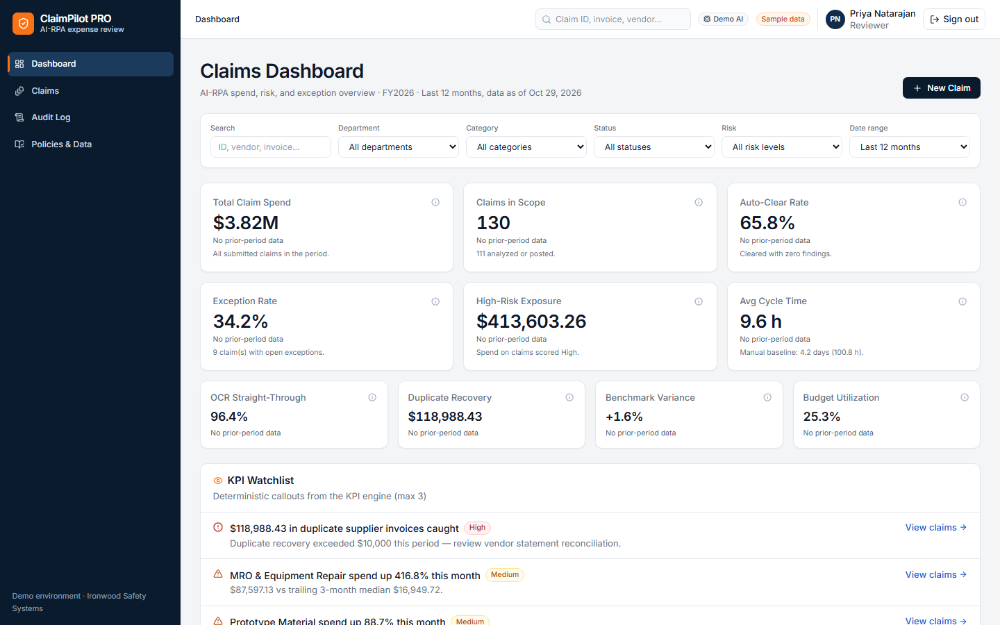 | 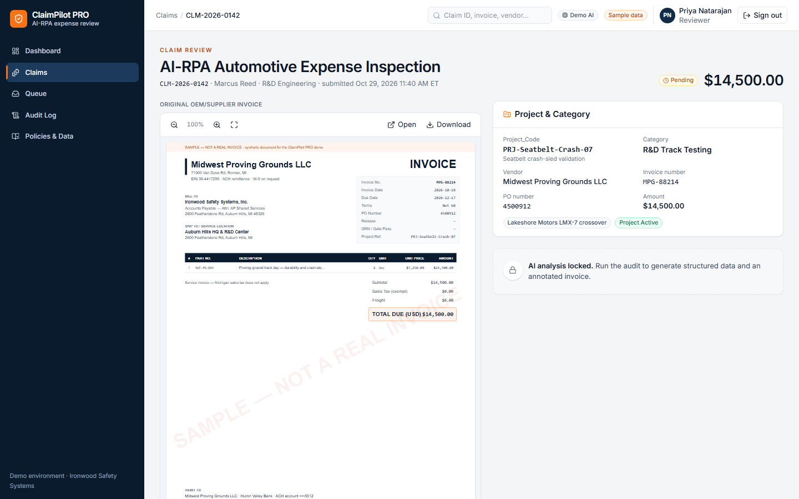 |
| **Dashboard**: KPIs, watchlist, charts, claims list | **Claim review, Pending**: AI panels are not in the DOM |
| 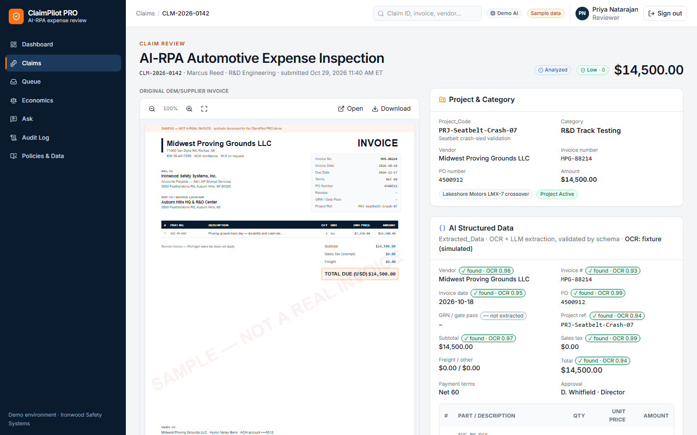 | 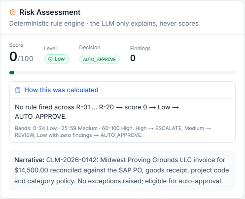 |
| **Claim review, Analyzed**: structured data + annotated invoice | **Risk panel**: "How this was calculated" expanded |
| 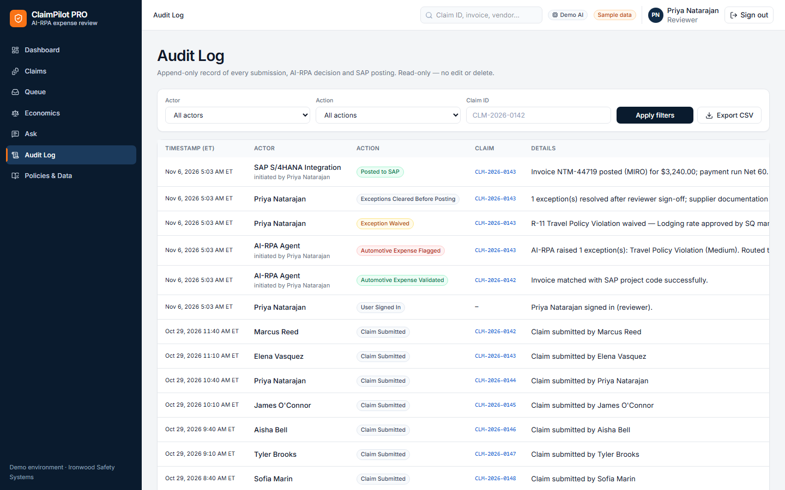 | 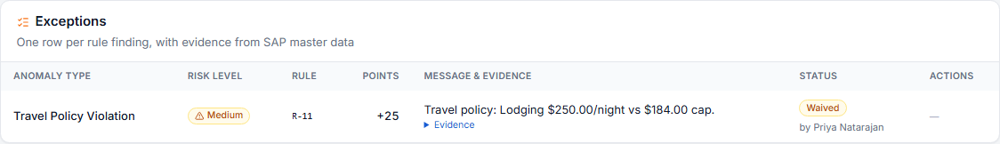 |
| **Audit log**: append-only trail; system rows show who initiated them | **Exceptions**: a handled exception shows who handled it |
| 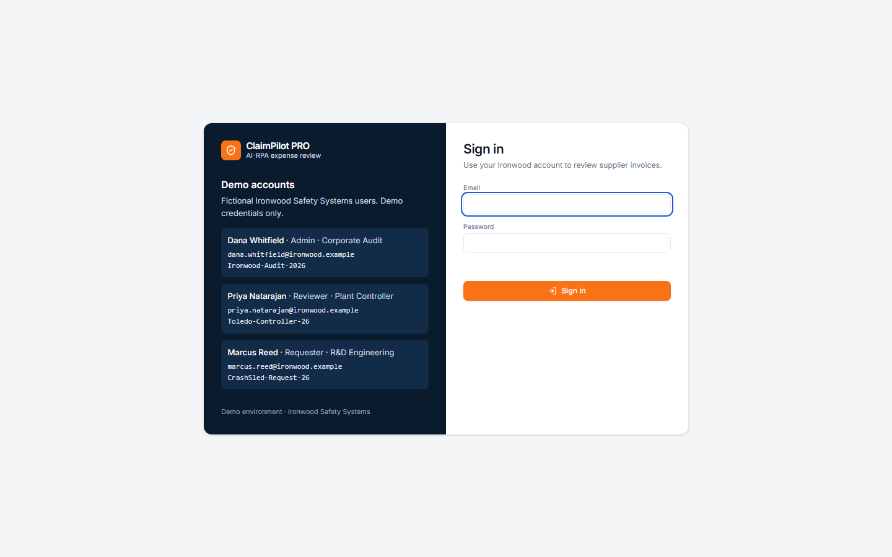 | |
| **Sign in**: every page requires a session; demo accounts listed | |
| 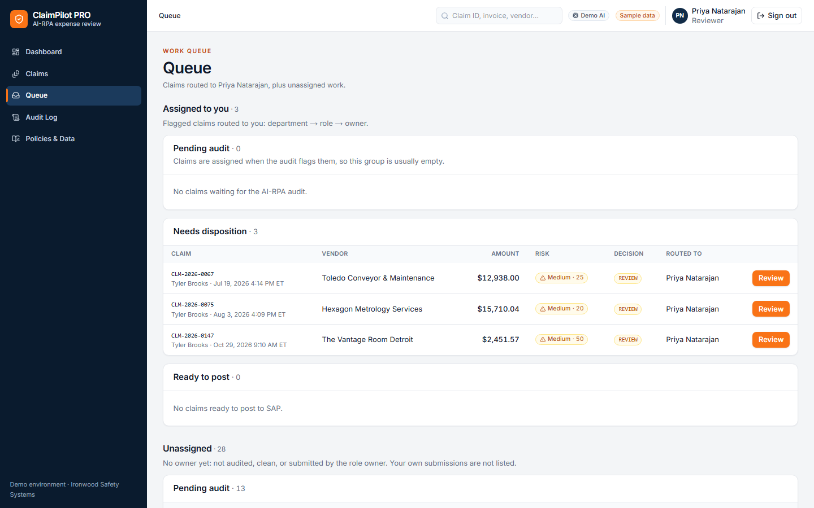 | 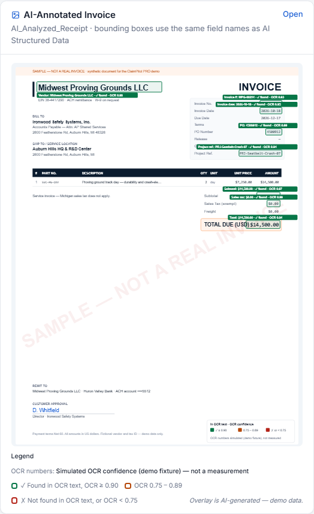 |
| **Queue**: assigned work by stage, plus an Unassigned section | **AI-annotated invoice**: green = found in the OCR text with OCR confidence ≥ 0.90, amber = 0.75–0.89, red = not found in the OCR text or OCR < 0.75. For seeded claims the OCR numbers are simulated (demo fixture), not measured; the card and the image say so |
| 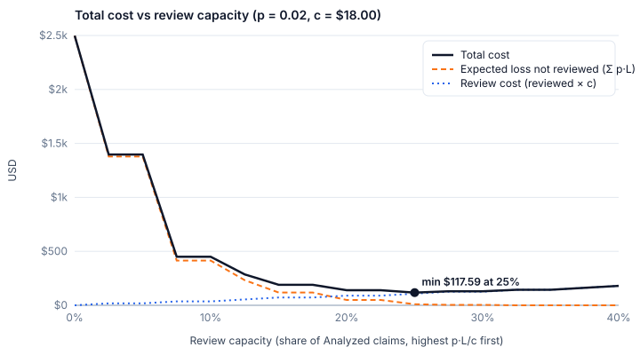 | |
| **Review economics**: total cost vs review capacity; the minimum sits where marginal expected loss crosses the $18 review cost | |

## Architecture

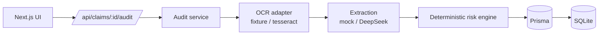

See [docs/ARCHITECTURE.md](docs/ARCHITECTURE.md) for the deterministic-vs-LLM boundary and the idempotency model.

Stack: Next.js 15 (App Router, React 19, TypeScript strict), Tailwind CSS 4 with shadcn-style primitives, Prisma + SQLite (portable to PostgreSQL), Zod, Recharts, date-fns-tz, Vitest.

## AI modes

| Variable | Values | Default |
|---|---|---|
| `AI_MODE` | `mock` · `live` | `mock` |
| `DEEPSEEK_API_KEY` | your key (server-side only) | empty |
| `DEEPSEEK_BASE_URL` | | `https://api.deepseek.com` |
| `DEEPSEEK_MODEL` | | `deepseek-chat` |
| `OCR_MODE` | `fixture` · `tesseract` | `fixture` |
| `MAX_UPLOAD_MB` | | `10` |

- **Mock (default):** seeded claims use deterministic fixtures generated with each receipt. No network. The badge reads *Demo AI*.
- **Live:** set `AI_MODE="live"` and `DEEPSEEK_API_KEY="…"` in `.env`, then restart `pnpm dev`. For seeded claims, the fixture OCR text is sent to DeepSeek for structuring and the risk narrative. For uploads, set `OCR_MODE="tesseract"` (PNG/JPEG; Tesseract fetches its English model on first use).
- **OCR first.** The default DeepSeek chat model is **text-only**, so images are never sent. OCR produces text and geometry; DeepSeek structures the text. Adding a vision model would go behind the same adapter (`src/lib/ai/`).
- **Grounded Q&A (`/ask`):** questions about claim status, vendor spend, policy limits and current priorities are answered from facts retrieved from the database. Intent detection and retrieval are deterministic; mock mode answers from templates, live mode lets DeepSeek phrase the same facts and discards any answer citing an id or amount that was not retrieved. See [docs/AI_GOVERNANCE.md](docs/AI_GOVERNANCE.md).
- **Grounding benchmark:** `pnpm bench:grounding` (offline, deterministic, needs `./eng.traineddata`) measures grounding's false alarms on degraded Tesseract scans and the rule ensemble's detection of injected extraction errors, with 95 % bounds and exposure weighting. Results: [docs/GROUNDING_BENCH.md](docs/GROUNDING_BENCH.md), raw rows in `docs/grounding-bench.csv`.
- The environment is validated at server start (`src/lib/env.ts`): a typo such as `AI_MODE="Live"`, a non-numeric `MAX_UPLOAD_MB`, or live mode without a key stops the server with one clear `[env] Invalid configuration — …` line instead of silently running in mock mode.
- Live mode with no key returns `503 AI provider is not configured`. If DeepSeek fails on a seeded claim, the audit falls back to the fixture (`AiRun.mode = fallback`) and shows a warning banner. If it fails on an upload, the response is `502` and the claim stays Pending.
- The key is never exposed to the browser (no `NEXT_PUBLIC_*`, all DeepSeek calls go through `server-only` modules) and is never logged.

## Demo path

Full script: [docs/DEMO_SCRIPT.md](docs/DEMO_SCRIPT.md).

| Claim | Expected | Audit log |
|---|---|---|
| **CLM-2026-0142** (Midwest Proving Grounds, $14,500) | 0 · Low · AUTO_APPROVE | `AI-RPA Agent` · `Automotive Expense Validated` · `Invoice matched with SAP project code successfully.` |
| **CLM-2026-0144** (Lone Star Robotics, $56,800) | 100 · High · ESCALATE | `AI-RPA Agent` · `Automotive Expense Flagged` · `AI-RPA raised 3 exception(s): Amount Over Limit (High), Missing Factory Gate Pass (High), PO Balance Exceeded (High). Routed to Plant Controller.` |
| CLM-2026-0143 / 0145 / 0146 / 0147 / 0148 | 25 Medium · 60 High · 65 High · 50 Medium · 65 High | Flagged |

### Claim lifecycle

`Pending` → **🚀 Run AI-RPA Audit** → `Analyzed` → reviewer resolves or waives each exception (with a note) → **Post to SAP** → `Posted` (MIRO document number). Posting is blocked while any exception is still Open. Every step is appended to the audit log.

**Routing:** a flagged claim is assigned by department → role (the same table that writes "Routed to …") → owner, the one employee with that title, and never to the claim's own submitter (the claim then stays assigned to the role with no owner, for someone else to pick up). Reviewers see their assigned claims plus an Unassigned section on `/queue`; requesters see their own submissions there, read-only (D-34).

The AI Structured Data and AI-Annotated Invoice blocks are **conditionally rendered**: absent from the DOM while `Pending`, present once the claim is `Analyzed` or `Posted` (DECISIONS D-19).

## Risk rules

Eighteen deterministic rules (R-01…R-18) feed a score capped at 100. Bands are 0–24 Low, 25–59 Medium and 60+ High, with a severity floor: any High finding makes the claim High. The decision is High → ESCALATE, Medium → REVIEW, and Low → AUTO_APPROVE only with zero findings. The LLM may explain findings but never sets the score. Details and examples: [docs/RISK_RULES.md](docs/RISK_RULES.md). Thresholds live in `src/lib/domain/constants.ts` and `src/lib/seed/master.ts`.

- **Review economics:** beside the score, an expected-loss layer decides whether reviewing a claim is worth it (`p·L > c`), ranks work by `p·L / c`, and treats R-03 and R-17 as always-review constraints. See [docs/ECONOMICS.md](docs/ECONOMICS.md), the `/economics` page, and `pnpm cost:curve` (writes `docs/cost-curve.csv` and `docs/images/cost-curve.svg`).

## KPIs

All values are computed from the database (`src/lib/kpi/formulas.ts`), and the dashboard, `/api/kpis` and `pnpm kpi:report` share the same code.

| KPI | Formula |
|---|---|
| Total Claim Spend | Σ amount in period |
| Claims in Scope | count in period |
| Auto-Clear Rate | AUTO_APPROVE ÷ Analyzed+Posted |
| Exception Rate | claims with ≥1 exception ÷ Analyzed+Posted (DECISIONS D-02) |
| High-Risk Exposure | Σ amount where risk = High |
| Avg Cycle Time | mean hours submittedAt → analyzedAt (manual baseline 4.2 days) |
| OCR Straight-Through | analyzed without Low OCR Confidence ÷ analyzed |
| Duplicate Recovery | Σ amount with a Duplicate Supplier Invoice exception |
| Benchmark Variance | amount-weighted (unit price − p50) ÷ p50 |
| Budget Utilization | project spend ÷ project budget |

Each card shows a delta against the previous equal-length period. The **KPI Watchlist** shows up to 3 deterministic callouts (budget > 90%, duplicates > $10k, high-risk rate > 15%, cycle time > 48 h, category spike, vendor concentration). Filters live in the URL and apply to both the cards and the list.

## Security notes

- Secrets live only in server env; `.env*` is git-ignored except `.env.example`.
- Authentication: email + password checked with Node `scrypt` (salted, `timingSafeEqual`), the same `401 INVALID_CREDENTIALS` for an unknown email and a wrong password, and sign-in throttling of 5/min per IP, 10/min per account, 1000/min globally, LRU-bounded in-memory buckets (single process). Throttled attempts appear on `/audit` as "Sign-in Throttled" (D-32). Sessions are random 32-byte tokens stored in the `Session` table (revocable, `SESSION_TTL_HOURS`, default 24 h) and sent as an `HttpOnly; SameSite=Lax` `cp_session` cookie (`Secure` whenever the request arrived over HTTPS, including behind a TLS-terminating proxy via `x-forwarded-proto`; D-30). The Edge middleware only checks that the cookie exists; the `(app)` layout and every API route validate the token against the database (401 `UNAUTHENTICATED`). Sign-in, sign-out and failed attempts are written to the audit log.
- Receipts are stored outside `public/` and served by `/api/receipts/:id/:kind`. File names come from the DB, never the URL, and claim IDs are regex-validated (no path traversal). Responses set `nosniff` and a restrictive CSP.
- Uploads are checked by magic bytes (PNG/JPEG/PDF), limited to 10 MB, and stored under random file names.
- Audit endpoint: same-origin check, 5 requests/min/claim rate limit, request ID on every response and error, and errors returned as `{ error: { code, message, requestId } }` with no stack traces.
- Model output is validated with Zod and rendered as escaped React text (`dangerouslySetInnerHTML` is never used). OCR text is delimited and treated as untrusted data.
- The audit log is append-only; there are no update or delete APIs.

## Known limitations

- SQLite and an in-memory rate limiter / in-flight guard assume a single node process.
- Authentication is local email/password only (no SSO, MFA, password reset or account lockout beyond rate limiting). Role enforcement is deliberately minimal: three server-side checks, not a permission matrix (D-27). Seeded historical audit rows remain attributed to "AP Shared Services".
- In mock mode, uploads can be stored and reviewed but not audited. Tesseract boxes aren't mapped to fields, so annotated uploads show a "Fields extracted" panel instead of boxes.
- PDF uploads need rasterization before OCR (not implemented); use PNG/JPEG for live OCR.
- Posting to SAP is simulated: it records a MIRO document number and audit entries but does not call SAP.
- There is no Playwright test suite. Playwright is only used by `pnpm shots` for screenshots; the golden path is covered by integration tests against a real DB plus a manual browser run (DECISIONS D-12).
- There is no self-service sign-up. Accounts are provisioned (seeded in the demo, SCIM/HR in production); an approval system must not let arbitrary users create an account, let alone pick a role. An admin-managed Users screen is the intended next step (D-29).
- Extraction confidence values are simulated: `fieldConfidence` is derived from `sha256(claimId + ':' + field)` mapped into [0.93, 0.995] (`src/lib/receipts/invoice.ts`). They are a UI fixture, not a calibrated probability. The seeded extraction is built from the document itself, so its true error rate is 0 — which also means R-14 can only fire on the deliberately seeded `lowOcr` samples (DECISIONS D-25). Since D-37, the confidence on a scored extraction always comes from the OCR layer (fixture or Tesseract page confidence), never from the model; chips show it next to a deterministic "found in the OCR text" check. The 130 fixtures are all correctly extracted, so they prove only that grounding does not false-alarm on clean data; [docs/GROUNDING_BENCH.md](docs/GROUNDING_BENCH.md) measures it on 650 degraded scans and 852 injected errors (`pnpm bench:grounding`).

## Production roadmap

PostgreSQL · SSO (Entra ID/Okta) with role-based access · SAP S/4HANA OData for PO/GR/vendor master and MIRO posting · Concur/Ariba connectors · managed OCR or vision model behind the same adapter · object storage with signed URLs · queue/worker for audits · approval workflow and exception resolution · Redis rate limiting · SOC 2 controls (audit-log immutability via WORM storage, key management, access reviews).
