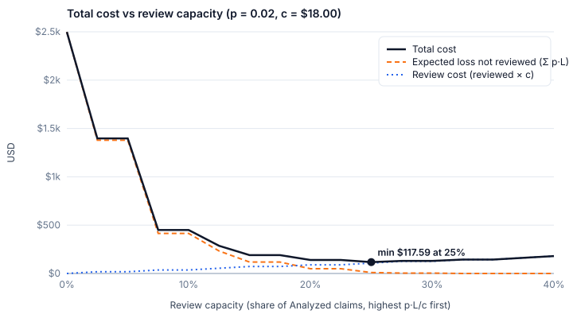

# Review economics

The risk engine (`src/lib/risk`, [RISK_RULES.md](RISK_RULES.md)) answers *how risky is this claim?* in points.
This layer answers a different question: **is reviewing it worth the money?** It sits beside the engine and never
changes a score, level, decision or audit wording (`src/lib/risk/exposure.ts`, `src/lib/risk/economics.ts`,
`src/lib/economics/assess.ts`, DECISIONS D-35).

## The rule

For a flagged claim, let

- **L**: exposure, the money lost if the findings are ignored and the claim is paid as submitted;
- **p**: the probability that the finding is a real loss;
- **c**: the cost of one human review.

Paying unreviewed costs `p·L` in expectation; reviewing costs `c`. So:

> **review ⇔ p·L > c**

Equivalently, review whenever `p` exceeds the **break-even probability** `p* = c / (L + c)`.

### Worked example

CLM-2026-0144 is a $56,800 invoice (L = $56,800 once capped; see below), with c = $18:

```
p* = 18 / (56,800 + 18) ≈ 0.000317  ≈ 0.032 %
```

Paying it unreviewed is only rational if you are at least **99.97 %** sure it is clean. At the demo's
p = 2 %, `p·L = $1,136`, about 63 times the cost of looking.

## Why a single confidence threshold is wrong

A rule like "auto-approve when the model is ≥ 75 % confident" fixes `p* = 0.25` for every claim. But `p*`
depends on the amount: with c = $18, `p* = 0.25` is right only for an invoice of $54. At $5,400 the right
threshold is 0.33 %; at $56,800 it is 0.032 %. **The confidence you need rises with the amount** (the
acceptable error probability falls), so any fixed threshold under-reviews large claims and over-reviews small ones.

## Ranking without knowing the true loss

Work is ranked by **priority = p·L / c**. If every exposure is off by the same factor k (we never know the
true fraud amount, only what the invoice states), every priority becomes `k·p·L / c`. The **order** is
unchanged, so capacity goes to the same claims. All the ranking needs is *relative* exposure, which the invoice,
PO and policy already give us. Only the review/clear cut-off (`p·L > c`) depends on the absolute scale, which is
why `p` and `c` are stated assumptions.

## Constraints, not expected value

**R-03 (duplicate invoice)** and **R-17 (bank-detail change)** are always reviewed, whatever the arithmetic
(`CONSTRAINT_RULES`):

- **Heavy tails.** A changed bank account is the classic payment-fraud vector; one loss is the whole payment,
  and repeat payments to the same account compound it. An average `p` hides that tail.
- **Non-monetary penalties.** Paying a duplicate or a fraudster triggers audit findings, control deficiencies
  and vendor-relationship damage that L does not price.

Expected value is the right tool for ordinary policy breaches. For these two it would be the wrong tool, so
they are constraints.

## How L is computed

`exposureFor(finding, input)` returns integer cents, or `null` when the finding is not monetisable.

| Rule | Exposure |
|---|---|
| R-03 duplicate, R-05 no gate pass, R-06 vendor not approved, R-17 bank change | full claim amount (all-or-nothing controls) |
| R-02 wrong project, R-18 expensed capital spend | full claim amount: the whole invoice is misallocated or misclassified |
| R-04 over limit | amount − per-claim limit (near-limit advisories: not priced) |
| R-07 PO exceeded | amount − (PO amount − consumed); no PO at all → full amount |
| R-08 price variance | Σ (unit price − benchmark p50) × qty; without line items, amount × v / (1 + v) |
| R-09 split invoice | same-vendor in-band spend within 7 days above the limit, at most this invoice |
| R-10 tax | arithmetic gap + tax above the highest plausible rate for the ship-to state |
| R-11 travel | excess over the lodging, airfare and per-diem caps |
| R-12 entertainment | larger of (spend above the per-head cap) and (alcohol billed) |
| R-15 approval breach | amount above the actual approver's authority; no approver → full amount |
| R-01, R-13, R-14, R-16 | `null`: not monetisable |

### Cap rule

`claimExposure` sums the per-rule exposures and **caps the total at the claim amount**. Several findings
often price slices of the same money (an over-limit amount that is also over the PO balance; a duplicate that
is also missing a gate pass). Paying an invoice can lose at most the invoice, so total exposure never exceeds it.

## The cost curve

`pnpm cost:curve` (read-only) ranks every Analyzed claim by priority and, for review capacity 0 → 40 % in
2.5 % steps, computes `reviewed × c` plus `Σ p·L` over the claims left unreviewed. It prints the table,
writes `docs/cost-curve.csv` and `docs/images/cost-curve.svg`, and names the capacity with the lowest total.
`/economics` draws the same chart from live data.



On the seeded data, reviewing nothing leaves about $2,498 of expected loss. Reviewing the top quarter
(6 of 24 claims, $108 of review time) brings the total to about $118, and reviewing more only adds cost.

### Where the minimum comes from

Only **8 of the 24** Analyzed claims carry any priced exposure (`L > 0`); the other 16 are clean or have only
non-monetisable findings. Past the 8th review the residual expected loss is `$0`, so every further review is
pure cost. The knee sits exactly where the marginal claim's `p·L` crosses `c`:

| Review | Expected loss saved | Review cost | Worth it? |
|---|---:|---:|---|
| 6th (22.5 % → 25 %) | $49.54 − $9.59 = **$39.95** | $18 | yes |
| 7th (25 % → 27.5 %) | $9.59 − $4.27 = **$5.32** | $18 | no |

The optimum is a property of this claim population and of `p`, not a universal percentage: a riskier
portfolio (more claims with large `L`) pushes it to the right.

**Sensitivity** (measured on the seeded data; `DEFAULT_ERROR_PROBABILITY` is one constant you can edit and
re-run `pnpm cost:curve`): at `p = 0.005` the optimum drops to 4 reviews (15 %, the three constraint claims
plus CLM-2026-0075); at `p = 0.05` it stays at 6, because the 7th claim's `L` is only $266 and is not worth $18
until `p > 18 / 266 ≈ 0.068`.

## Assumptions and limits

- **Review is perfect.** A reviewed claim is assumed to catch the error with certainty; real reviewers miss some.
- **Loss = exposure.** No partial losses; L is what the invoice puts at risk.
- **No recovery.** Money paid in error is assumed gone (no clawback, credit memo or insurance).
- **p is a demo constant**, `DEFAULT_ERROR_PROBABILITY = 0.02`, not a measurement. The extraction confidence
  shown in the UI is simulated too (README "Known limitations", DECISIONS D-25); a real deployment would
  estimate `p` per rule from historical outcomes.
- **c is a demo constant**, `REVIEW_COST_CENTS = $18` (about 15 minutes of an AP analyst's loaded time).
- Findings are re-derived with the same pure engine and `buildRiskInput` the audit uses; nothing is written.
